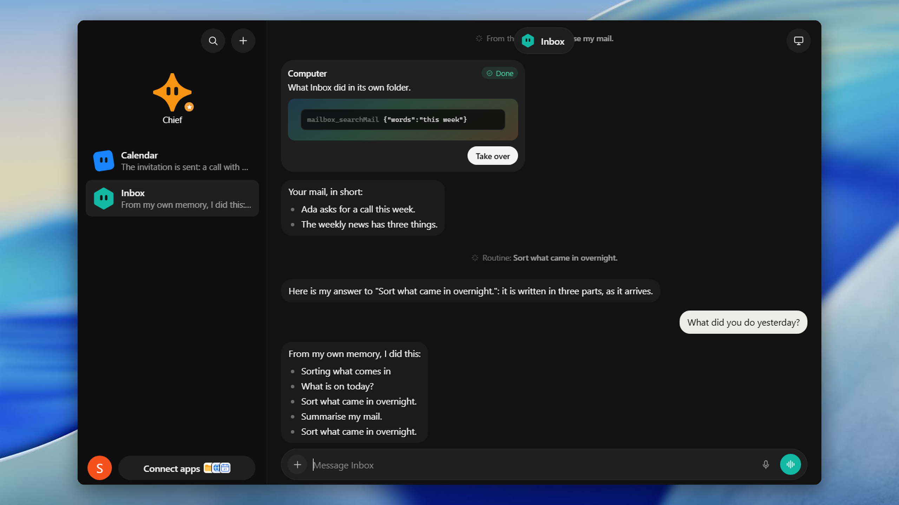
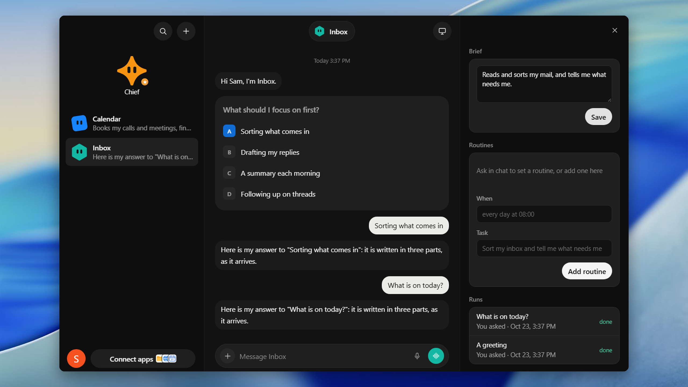
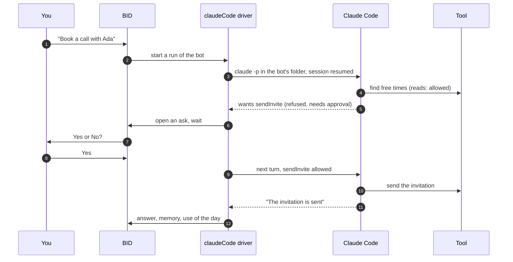

<div align="center">

# BID

**Bots in disguise: always-on bots that work for you, on your own computer.**

Give each bot a name, a brief and a schedule. A chief routes what you ask to the right bot, and nothing is sent, paid for or deleted until you say Yes.

[](LICENSE)


[Quick start](#quick-start) · [Running](docs/running.md) · [Architecture](docs/architecture.md) · [Security](SECURITY.md) · [Contributing](CONTRIBUTING.md)

</div>

---





BID runs a small team of bots on your own computer. Each bot is [Claude Code](https://docs.claude.com/en/docs/claude-code) working in a folder of its own, with a brief that says what it is for and a memory that lasts.

- **Bots with their own memory.** Each bot keeps its own Claude Code session, files and skills. No bot sees another bot's memory.
- **Routines.** "Every morning at eight": a bot runs on its schedule with nobody asking.
- **A chief.** Tell the chief what you need. It splits the request into tasks, hands each to the bot whose brief fits, and asks you when no bot does.
- **Yes or No first.** Before a bot sends, pays or deletes, it asks you. Nothing happens until you answer.
- **Your tools through MCP.** Files, a browser, or any MCP server of your own, chosen per bot.
- **Limits you set.** A daily token limit for all bots, and a setting for whether bots may run commands.
- **Local.** The account, the data and the bots' folders stay on your computer. It also runs in a desktop window.

## How it works

A message, a routine or the chief starts a run of a bot. The driver runs Claude Code once per turn in the bot's folder and resumes its session. When Claude Code wants a tool that needs your approval, the run waits for your answer:



It is one [Tent.js](https://tentjs.com) app: tables, functions, flows, two agents and the screens, plus a driver that runs Claude Code and a small MCP bridge for the app's own tools. The [architecture guide](docs/architecture.md) covers a run, the asks, the chief, routines, the account and what is kept on disk. [docs/architecture.html](docs/architecture.html) is an interactive map of the whole system, where each box links to its source (download it and open it in a browser).

## Quick start

Requirements: Node.js 26, and a Claude subscription or an Anthropic API key.

```sh
git clone https://github.com/ArynBuilds/BID.git && cd BID
npm install          # the app, and Claude Code with it
npm run setup        # creates data/ and the key for its secrets, once
npx claude           # sign in to Claude Code, or add an API key in Settings later
npm start
```

Open `http://127.0.0.1:4805` and create your account. It is stored only on this computer.

The [running guide](docs/running.md) covers connecting Claude, starting the app whenever you sign in to your computer, the desktop window, MCP apps, your own mail and calendar, settings, backups and troubleshooting.

## Security

- One account per computer, created on the first visit. After that, nobody can create another.
- The app listens on `127.0.0.1` only. An API key is encrypted in `data/`, and Settings shows only its last four characters.
- Bots edit files in their own folders without asking. Tools that act, and commands unless you allow them, wait for your Yes.

Read [SECURITY.md](SECURITY.md) for what a bot can and cannot do, and report vulnerabilities privately as described there.

## Status

BID was made for personal use and to test the Tent.js framework: it is the first larger app built with it. It is shared as it is, young software rather than a product.

- Each bot has a folder and the tools you give it, but no machine of its own.
- The interface is in English only.
- A bot runs only while the app is running: use `tent service` to keep it on.

## Development

```sh
npm run dev      # with the demo account: sam@example.com / a long secret
npm run check    # every Tent.js finding at once
npm run lint     # Biome
npm test         # no test calls Claude: stand-ins answer in its place
```

[CONTRIBUTING.md](CONTRIBUTING.md) covers the setup, the conventions and the pull-request checklist. Please follow the [Code of Conduct](CODE_OF_CONDUCT.md).

## License

[MIT](LICENSE) © 2026 BID contributors.
