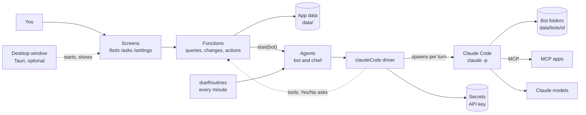

# Architecture

tent-bots is one [Tent.js](https://tentjs.com) app that runs on your own computer. The Tent.js engine serves the screens, keeps the data and runs the flows. Every bot turn is a run of [Claude Code](https://docs.claude.com/en/docs/claude-code) in that bot's own folder. One install serves exactly one person.

[architecture.html](architecture.html) is an interactive map of the same system, where each box links to its source. Download it and open it in a browser.

- [1. System overview](#1-system-overview)
- [2. The Tent.js pieces](#2-the-tentjs-pieces)
- [3. A bot run](#3-a-bot-run)
- [4. Asks: Yes or No before it acts](#4-asks-yes-or-no-before-it-acts)
- [5. The chief and handing work over](#5-the-chief-and-handing-work-over)
- [6. Routines](#6-routines)
- [7. Reaching Claude](#7-reaching-claude)
- [8. The account](#8-the-account)
- [9. What is kept on disk](#9-what-is-kept-on-disk)
- [10. Tests](#10-tests)
- [11. Source layout](#11-source-layout)
- [12. Tech stack](#12-tech-stack)

---

## 1. System overview



Everything inside the Tent.js engine listens on `127.0.0.1:4805` and nowhere else. Claude Code calls the Claude models with your sign-in or your API key. Each MCP app is a server that Claude Code starts by its command or reaches at its address.

## 2. The Tent.js pieces

A Tent.js project is a set of definitions, each a top-level `export const name = <word>('name', { ... })`. `AGENTS.md` lists the words; `npm run check` checks every rule at once.

| Kind | Where | What it holds |
|---|---|---|
| `project` | `tent.ts` | The app, its title and its sign-in screen |
| `table` | `tables/` | Bots, routines, memories, asks, turns, apps, skills, preferences, users |
| `query`, `change`, `action` | `functions/` | Everything the screens and the driver call. A `change` is the only thing that writes data |
| `flow` | `flows/` | `dueRoutines` every minute, and `sendInvite`, which states `danger: 'ask'` |
| `agent` | `agents/` | `bot`, the agent of every bot, and `chief` |
| `model` | `models/` | `thinker` (Opus) and `quick` (Haiku), with a day's limit per caller |
| `service` | `services/` | `mailbox` and `calendar`, two MCP servers of your own |
| `screen` | `screens/` | `/sign-in`, `/bots`, `/bots/:id`, `/asks`, `/apps`, `/settings`, `/used` |

`engine.ts` adds the one piece Tent.js does not ship: the driver `claudeCode`, which the two agents name with `driver: 'claudeCode'`.

## 3. A bot run

A run of the `bot` agent starts when you send a bot a message, when a routine comes due, when the chief hands it a task, or when a new bot greets you. Its `thread` is the bot's id. The driver (`driver/run.ts`) then works in steps, so a run that waits survives a restart:

1. **Read the bot.** `botOfRun` returns the bot's row, its apps, its skills, the other bots and the execution setting.
2. **Check the limit.** The engine checks the model's limit, and `dayLimitOf` refuses the run with `day-limit` once the bots used the day's tokens.
3. **Run a turn.** The driver writes the bot's skills into `.claude/skills/` of its folder, opens the MCP bridge, and spawns `claude -p` in the bot's folder with `--output-format stream-json`. It resumes the session in `.session`, or starts one. The text is streamed to the screen as it arrives.
4. **Keep what happened.** `remember` writes your message, the answer and each tool call to `memories`. `endTurn` writes the state and the use of the run to `turns`. Skills that Claude Code wrote are copied back with `keepSkill`.
5. **Ask or end.** A question block or a refused tool becomes an ask (section 4). Otherwise the run ends. One run takes at most 12 turns.

A bot's memory is its Claude Code session and its folder. A bot never sees another bot's session, folder or rows.

**The MCP bridge.** For each turn the driver opens a small MCP server on `127.0.0.1` at a free port, with a random bearer token, and closes it when the turn ends (`driver/bridge.ts`). Through it Claude Code reaches the app's own tools: the services and functions in the agent's `tools`. Each call is made in the run's own call context, so every tool keeps its access rule.

## 4. Asks: Yes or No before it acts

Claude Code runs with `--permission-mode acceptEdits` and a list of allowed tools:

- MCP tools whose names start with `read`, `search`, `find`, `get`, `list` or `look`, and queries that state no `danger`, are allowed.
- The tools of the apps you switched on for the bot are allowed.
- `Bash` and `PowerShell` follow **Settings › Computer › Execution**: ask every time (the default), always allow, or never allow.
- Everything else, `sendInvite` among it, is refused by Claude Code and reported in `permission_denials`.

The driver turns the first refused tool into an ask (`openAsk`), and the run waits on `step.waitFor`. You answer on `/asks` or in the bot's talk. `answerAsk` approves or refuses the waiting step. On Yes the tool is added to the allowed list and the next turn does it; on No the bot is told not to do it, nor anything in its place.

A question block with lettered choices in an answer becomes an ask of the kind `question` in the same way, and your choice is the next turn's prompt.

## 5. The chief and handing work over

The chief is a row of `bots` with `kind: 'chief'`, made with each account. It runs on the `quick` model with `--json-schema`, so it answers a routing: what to say, and a list of tasks for bots by name (`driver/chief.ts`). For each task the driver calls `handTask`, which starts a run of that bot under the chief's run. `runsUnder` lists them, so the chief's talk shows every hand-over. When no bot fits, the chief asks you which bot should take the task.

## 6. Routines

A routine belongs to a bot. It has a schedule (`every`) or an event (`on`), a task, and the next moment it comes due. `addRoutine` reads a schedule written in words, such as "every morning at eight", with `lib/schedule.ts`. The flow `dueRoutines` runs every minute. `startDueRoutines` starts a run of each routine whose `next` has come and moves `next` on.

## 7. Reaching Claude

The driver finds Claude Code in this order: `BOTS_CLAUDE` (a JSON list of words, which the tests point at a stand-in), the copy that `npm install` puts in `node_modules/@anthropic-ai/claude-code`, then `claude` on the path.

- **Claude Code sign-in.** The default. Claude Code uses the account you signed in with (`npx claude`).
- **API key.** `setClaudeKey` keeps the key as the secret `ANTHROPIC_API_KEY`, encrypted in `data/`. Only its last four characters are written beside your preferences, for Settings to show. The driver reads the key for each turn and passes it to Claude Code as `ANTHROPIC_API_KEY`. `removeClaudeKey` forgets it.

`--setting-sources project,local` keeps your own global Claude Code settings out of the bots' runs. The models are named by Claude Code's aliases, `opus` and `haiku`.

## 8. The account

The app has one account, kept on this computer. `hasAccount` tells the sign-in screen whether one exists. Without one, the screen shows **Create your account**, and `createAccount` hashes the password and calls `addOwner`. `addOwner` refuses once any user exists, and makes the user, their preferences, the chief and the starter apps. Sign-in tries are limited to 5 in 10 minutes per email and address.

`seed.ts` adds the demo account `sam@example.com` for development and tests only. `tent start` applies no seed, so a real install starts empty.

## 9. What is kept on disk

| Path | Holds | Written by |
|---|---|---|
| `data/` | The Tent.js data of the app: every table, the runs and their steps | The engine |
| `data/secret.key` | The key that encrypts the secrets | `npm run setup`, once |
| `data/secrets.live` | The secrets, each encrypted by itself | `setClaudeKey`, `tent secrets set` |
| `data/bots/<id>/` | A bot's folder: its files, `.claude/skills/`, `.session` | The driver and Claude Code |
| `build/` | The bundle that `npm start` builds | `tent build` |

None of these are committed. Back up `data/` to keep your bots, and keep `data/secret.key` private.

## 10. Tests

| File | Proves |
|---|---|
| `tests/engine.test.ts` | The greeting and its question, a routine at eight, the chief's hand-over, Yes and No before a send, a bot's own memory, the day's limit |
| `tests/setup.test.ts` | No second account on a computer; an API key kept, shown by its last four characters, and forgotten |
| `tests/walk.test.ts` | The whole walk in a browser, in Chromium, Firefox and WebKit (`WALK_ENGINES` picks some) |

No test calls Claude. `fakes/claude.ts` and `walk/slow-claude.ts` answer in Claude Code's streamed form, and `fakes/tools.ts` stands in for the mail and calendar servers. Tent.js fakes every model and the clock in tests.

## 11. Source layout

```
tent.ts              the project
engine.ts            registers the claudeCode driver
agents/              bot and chief
driver/              a run as Claude Code turns: run.ts, claude.ts, bridge.ts, chief.ts, question.ts, tools.ts
flows/               dueRoutines, sendInvite
functions/           queries, changes and actions of every screen and of the driver
tables/              the data
models/              thinker and quick
services/            mailbox and calendar (MCP)
screens/, components/  the interface and its CSS
lib/                 schedules and the bots' looks, shared by both sides
desktop/             the Tauri window (Rust)
fakes/, walk/        stand-ins for the tests
tests/               engine, setup and walk tests
scripts/setup.mjs    makes the data folder's key
```

## 12. Tech stack

| Part | Uses |
|---|---|
| App framework | Tent.js |
| Bots | Claude Code, in print mode with streamed JSON |
| Models | Claude Opus and Claude Haiku |
| Tools | MCP over stdio and HTTP |
| Interface | React, through Tent.js screens |
| Desktop window | Tauri 2, Rust |
| Runtime | Node.js 26 |
| Formatting and lint | Biome |
